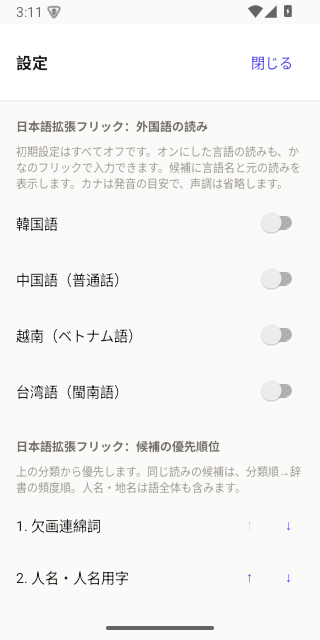
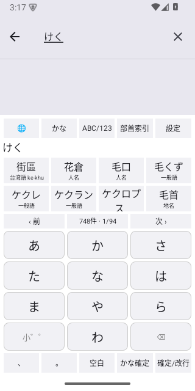
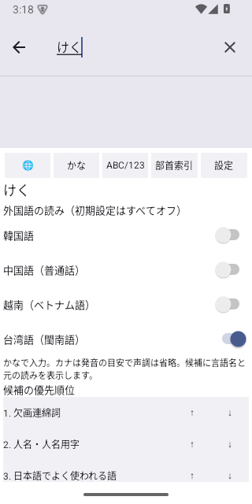
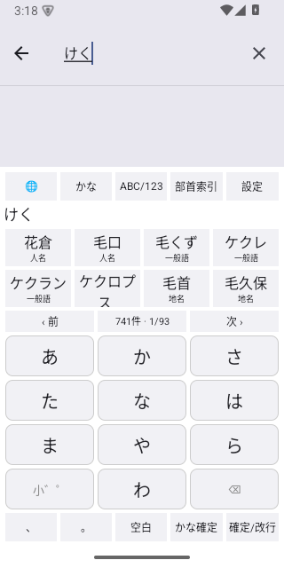
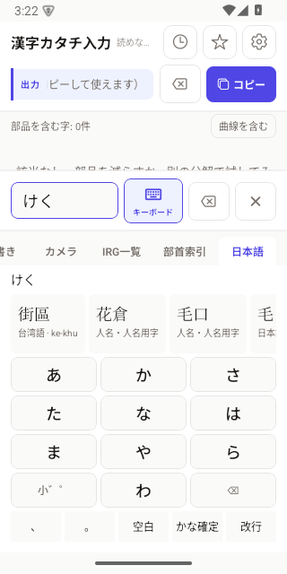

# 外国語の読みのオン・オフ設定

2026-10-29、未配信の1.0.12に追加。
対象はアプリ内の「日本語」タブと、独立したOS入力方式「日本語拡張フリック」です。

## 動作

- 韓国語、中国語（普通話）、越南（ベトナム語）、台湾語（閩南語）を個別に設定。
- 初期値は全言語オフ。未設定・不正な保存値・未知の言語IDから自動的に有効にはしません。
- 有効にした言語の発音を、かなのフリックで検索可能。候補に言語と元の読みを表示。
- 同じ読みのまま設定を切り替えても再検索し、オフにした言語の候補を除外。
  日本語にも同じ読みのある表記は、日本語候補として残ります。
- 既存の分類順は保持し、同じ一致条件では日本語の候補を先に表示。
- アプリ設定とOSキーボードで同じ`katachi.foreignReadings.v1`を共有。
  iOSで共有アクセスがない場合は拡張内の設定を使用します。

かなは検索のための発音の目安で、声調などの違いは省略します。
音から日本語の音読みを推定する処理は行いません。

## 資料と生成

| 言語 | 資料 | 収録する読み・表記の組 |
| --- | --- | ---: |
| 韓国語 | Unihan 18.0 `kHangul` | 8,917 |
| 中国語（普通話） | Unihan 18.0 `kMandarin`の中国本土側の値 | 44,345 |
| ベトナム語 | Unihan 18.0 `kVietnamese` | 8,655 |
| 台湾語（閩南語） | iTaigi華台對照典 / ChhoeTaigi資料庫、CC0 | 14,908 |

計76,825組。各言語の網羅を意味しません。
台湾語は利用者の確認に基づき、台湾華語とは別の閩南語を採用しました。
転写できない音節や漢字表記のない項目は取り込みません。
元資料・ハッシュ・固定コミット・再生成方法は[辞書資料](../data-src/japanese/README.md)を参照。

## 検証

| 確認 | 結果 |
| --- | --- |
| Native TypeScript型チェック | 成功 |
| 日本語・外国語・部首のデータと検索テスト | 6テスト成功 |
| SwiftとTypeScriptの候補比較 | 448項目成功 |
| KotlinとTypeScriptの候補比較 | 448項目成功 |
| Android arm64 debugビルド | 成功 |
| iOS本体と両キーボードを含むシミュレータービルド | 成功 |
| `git diff --check` | 成功 |

比較テストでは各言語を単独でオンにする場合、全言語オン、同じ読みのまま全オフへ
戻す場合を検証。先頭と末尾のページ、候補総数、言語IDと原語表記も比較しています。

Android 15 / API 35の専用テスト端末では、以下を画面で確認しました。

1. 新しい設定キーがない状態で、アプリ内の4スイッチがすべてオフ。
2. アプリで台湾語だけオンにし、共有保存値が`["tw"]`となる。
3. OSキーボードでも台湾語だけオンとなり、`けく`で`街區`（ke-khu）を表示。
4. 同じ読みを保持したままキーボードで台湾語をオフへ戻すと、候補が748件から741件へ減少。
   `街區`の台湾語候補が消え、共有保存値が`[]`となる。
5. アプリの設定へ戻っても、4スイッチすべてオフとなることをUI XMLで確認。
6. アプリ自身のフリック面でも、台湾語をオンにして`けく`を入力すると、
   `街區`と`台湾語 · ke-khu`を表示することをUI XMLと画面で確認。

iOSはビルドと同一検索フィクスチャによる検証まで。実機での操作確認と配信は未実施です。
新しい辞書資産を含むため、利用者への提供には1.0.12のネイティブビルドが必要です。
