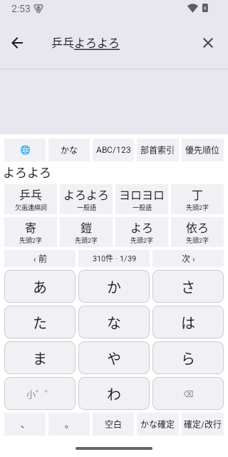
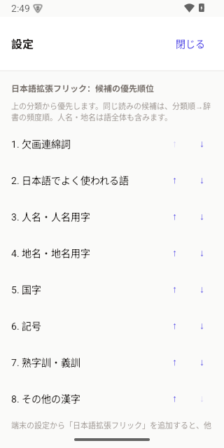
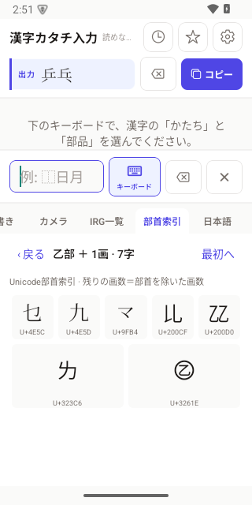
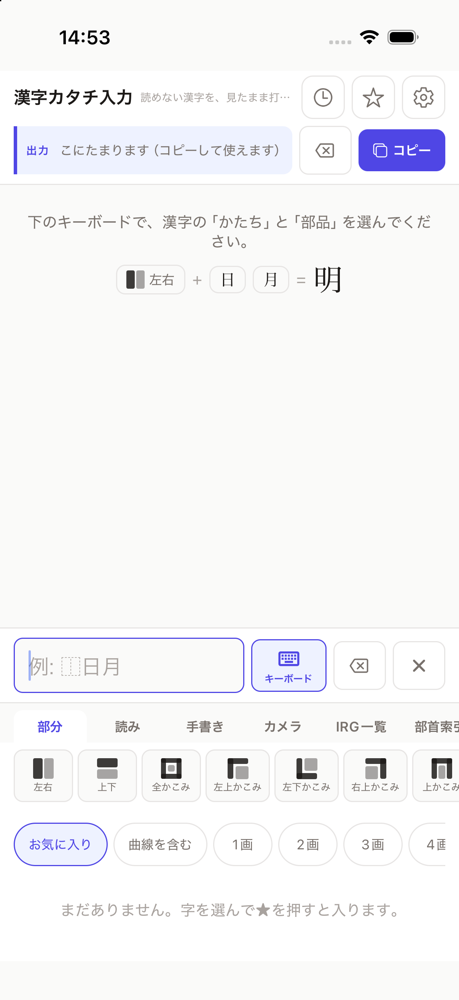

# 日本語拡張フリック・Unicode部首索引の実装検証

追記: 「乒乓」の読みは後に複数文献の確認基準へ変更しました。
[現在の採用・保留と検証](verification-2026-10-29-pinpon-readings.md)を参照してください。
以下の「よろよろ」による画面操作は、変更前に実施した検証の記録です。

検証日: 2026-10-29。対象: 1.0.12 / iOS build 21 / Android versionCode 20。
この記録はローカル実装・検証の記録であり、ストア配信・OTA配信の完了記録ではありません。

## 実装

- 既存の「漢字カタチ入力」に加え、独立してOSに追加できる「日本語拡張フリック」。
  Androidは別InputMethodService、iOSは別キーボード拡張。
- 12キーフリック、英数・大文字、句読点、空白、かな確定、削除、改行。
  読みの完全一致・予測候補・先頭単語の候補を提示し、先頭だけ確定した際は残りを保持。
- 一般語、人名、地名、国字、記号、欠画連綿詞、熟字訓・義訓、その他の漢字を↑↓で並べ替え。
  アプリの設定とOSキーボードで共有。iOSで共有アクセスを許可しない場合は拡張内の設定を使用。
- 部首の画数 → 部首 → 残りの画数 → 文字のUnicode部首索引。
  アプリ内、既存キーボード、新キーボードのそれぞれから利用可能。

辞書は1,626,865件の読み・表記の組。一般語803,249件、人名530,027件、地名240,234件、
その他の漢字123,518件、記号4,858件、熟字訓・義訓516件、国字248件、欠画連綿詞2件。
分類は重複するため合計は一致しません。低頻度を理由に除外せず、ページ送りで後続候補も選べます。
欠画連綿詞は「乒乓／よろよろ」「乒乓く／よろめく」の出典を確認した表記から開始しています。
出典・取り込み規則・再生成方法は[辞書資料](../data-src/japanese/README.md)を参照。

## 自動検証とビルド

| 項目 | 結果 |
| --- | --- |
| `python3 scripts/build-japanese.py` | 原資料SHA-256を検証し、86分割の辞書と部首索引を再生成 |
| `npm --prefix native run typecheck` | 成功 |
| `npm --prefix native run test:japanese` | 5テスト成功。全行の分類・順序・件数、珍しい読み、部分確定、部首所属を検証 |
| Swift / Kotlin の同一フィクスチャ | 各142項目成功。候補総数、先頭・末尾ページ、分類順位、U+3261Eの複数部首所属など |
| 既存 `test:input` / `test:irg` | 5件 / 6件成功 |
| Expo export iOS / Android | 成功。JSバンドルは各約14MB |
| Android `assembleDebug` | arm64-v8aビルド成功 |
| iOS新・既存キーボード単体ビルド | 両方成功 |
| iOS本体・両拡張を含むworkspaceビルド | arm64シミュレーター向け、署名なしで成功 |
| `git diff --check` | 成功 |

辞書をJSに埋め込む構成は取りやめ、アプリ本体もネイティブ資産のTSVを必要な分だけ非同期で
読み込みます。iOS本体は同梱の`PlugIns/japanese.appex/japanese-XXXX.tsv`を参照し、
Androidは共通assetsを参照します。キーボード拡張はJSを起動せず、現在の分割辞書だけを保持。

通常のアプリ起動経路で、両OSのネイティブAPIに対して以下を実行しました。
一時テストコード・ポート転送は検証後に除去済みです。

- `3088`の辞書から「よろよろ → 乒乓」を読み込める。
- 未存在の`ffff`は空文字を返す。
- パス形式の不正キー`../3088`は拒否される。

[両OSの実行結果](verification-2026-10-29-japanese-input/native-shard-runtime.json)

## 画面操作

新規のAndroid 15 / API 35テスト端末で、次の流れを確認しました。既存端末のアプリデータは削除していません。

1. OSの入力方式一覧に既存IMEと新IMEが両方表示される。
2. OS設定アプリの検索欄で、新IMEから「よろよろ」をフリック入力。
3. 欠画連綿詞を最上位に移すと「乒乓」が先頭候補となり、タップするとホスト入力欄へ確定。
4. 部首索引で1画 → 乙部 → 残り1画を選び、U+3261Eを入力。XML上の符号位置も一致。
5. アプリ内の日本語タブも同じ分類順で「乒乓」を表示・確定。
6. アプリの設定で人名分類を上へ移し、共通SharedPreferencesへの保存を確認。
7. アプリ内の部首索引でもU+3261Eを選択し、出力が`乒乓` + U+3261EとなることをXMLで確認。

iOS 26.5 / iPhone 17シミュレーターでは本体アプリのインストールと起動、上記辞書APIを確認。

## 検証環境と範囲

- ローカルCocoaPodsが日本語を含むパスで文字コードエラーになったため、一時ASCIIパスの
  コピーで依存関係を準備し、iOS全体をビルドしました。元の設定をパス回避のために変更していません。
- デバッガーの`Runtime.evaluate`から直接非同期コードを試すと、両OSでHermesの
  `CodeBlock::getSourceLocation` / `Debugger::runUntilValidPauseLocation`がクラッシュしました。
  この方法の結果を成功扱いせず、デバッガーを使わない通常起動でAPI検証をやり直し、成功を確認しています。
- 実機iPhone上のキーボード追加・入力、署名付き配布ビルド、App Store / Google Play配信は未実施。
- 入力は読みから単語を選ぶ方式です。文脈に応じた自動連文節変換・学習機能は含みません。
  熟字訓・欠画連綿詞の分類は確認済み資料の範囲で、網羅を意味しません。
- ネイティブの入力方式追加とAPI追加を含むため、既存1.0.11向けOTAでは提供できません。
  利用者への提供には1.0.12の新しいネイティブビルドが必要です。

## 実装上の補足

`@bacons/apple-targets` 5.0.0は同種の拡張ターゲットを再利用するため、そのままでは
2つの独立したキーボードを生成できません。`native/plugins/withAppleTargets.js`で
製品名によるターゲット選択と設定リスト削除時の参照保持を修正し、同版に固定しています。
更新時にはアダプターが対象ソースを検査して停止するため、上流修正の有無を確認してください。
