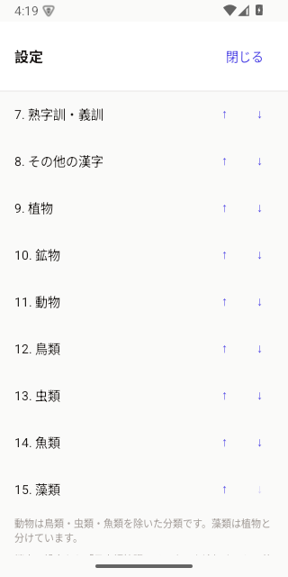

# 自然分野の変換候補と並び替え

2026-10-29、未配信の1.0.12に追加。
アプリ内の「日本語」タブと、OS入力方式「日本語拡張フリック」に対応します。

## 変更

植物・鉱物・動物・鳥類・虫類・魚類・藻類を加え、合計15分類を並べ替え可能にしました。
以前に保存した分類の順番を保持し、新しい7分類を末尾に追加します。
既存の分類ID・ビット位置・保存キーは維持しています。

原辞書にある読み・表記の組を4,396組追加し、日本語の収録は1,631,260組になりました。
同じ読みで新分類を上へ移すと、その分類の候補を優先します。
既存候補にも新しい分類を付けています。下記は分類内の読み・表記の組の件数で、
生物種数や鉱物種数ではありません。分類は重複する場合があります。

| 分類 | 件数 | 変換例 |
| --- | ---: | --- |
| 植物 | 2,464 | あやめ → 菖蒲、たんぽぽ → 蒲公英 |
| 鉱物 | 392 | せきえい → 石英 |
| 動物 | 2,503 | あざらし → 海豹、くじら → 鯨 |
| 鳥類 | 1,199 | つばめ → 燕、かわせみ → 翡翠 |
| 虫類 | 783 | とんぼ → 蜻蛉 |
| 魚類 | 1,114 | さば → 鯖 |
| 藻類 | 74 | こんぶ → 昆布、もずく → 海雲 |

## 分類の根拠

JMdictの分野タグと語義の自然物名に対する対応表を使います。
一般名に分野タグのない項目もあるため、タグだけを抽出する方式にはしていません。
読みを語義から創作せず、原辞書の`re_restr`・`re_nokanji`・`stagk`・`stagr`を尊重します。

- 動物は鳥類・虫類・魚類を除いた分類。藻類は植物と別に扱います。
- 虫類は昆虫に限らず、通称としての虫（クモ・ムカデ・ミミズなど）を含みます。
- JMdictの`fish`タグは「釣り」であり、魚類にそのまま対応させません。
- 同じ読みでも「桜」と「偽客」のように異なる語義に使う表記は区別します。
- 「クリケットという競技」「印章のseal」「機械のworm」「海苔を巻いた料理」などを
  自然物名として誤分類しないための除外条件を設けています。

検索のための分類であり、網羅的な分類学データベースではありません。
分野タグに基づく関連用語も含みます。
規則は`data-src/japanese/nature-categories.json`、根拠となった項目・語義は
`nature-audit.jsonl`に記録。詳細と再生成方法は[辞書資料](../data-src/japanese/README.md)を参照。

## 検証

| 確認 | 結果 |
| --- | --- |
| 分類のPythonテスト | 9件成功 |
| 検索・辞書・設定のTypeScriptテスト | 8件成功 |
| Swiftとの候補比較 | 618項目成功 |
| Kotlinとの候補比較 | 618項目成功 |
| Native TypeScript型チェック | 成功 |
| Android arm64 debugビルド | 成功 |
| iOS本体と両キーボードを含むシミュレータービルド | 成功 |
| 代表読みの同梱辞書資産と生成元の一致 | 両OSで確認 |
| `git diff --check` | 成功 |

検索テストでは各分類を最上位にしたときの候補、鯨が魚類にならないこと、
かわせみの「翡翠」に鉱物の分類を流用しないこと、昆布を藻類とすること、
カナ専用の読みがカナ表記で変換できることも確認しました。

Android 15 / API 35の専用テスト端末では、アプリ設定に7分類が表示されることを確認。
「植物」の↑を押し、全15分類を保持したまま「その他の漢字」より上に保存されることを確認しました。

[操作後の保存順](verification-2026-10-29-nature-categories/saved-order.json)

iOSはビルドと共通検索フィクスチャによる検証まで。実機iPhoneでの操作確認・配信は未実施です。
